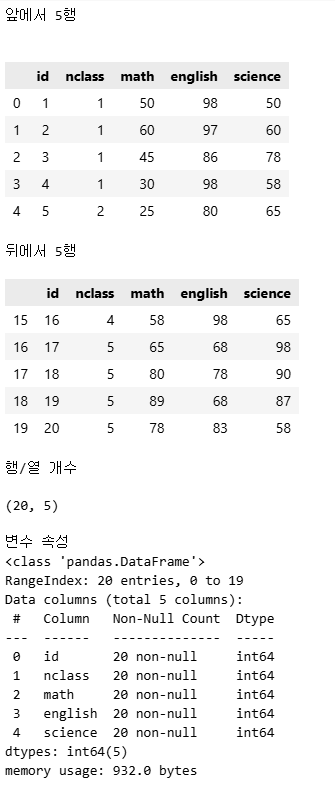

# 5. 데이터 분석 기초

# 5.1. 데이터 파악하기

### 데이터를 파악할 때 사용하는 명령어

- head(): 앞부분 출력
- tail(): 뒷부분 출력
- shape: 행, 열 개수 출력
- info(): 변수 속성
- describe(): 요약 통계량 출력

### exam 데이터 파악하기

```python
print('앞에서 5행')
print()
display(exam.head()) # 앞에서 5행까지 출력
# head() 메서드에 매개변수(int형)을 주면 해당 개수까지 출력

print('뒤에서 5행')
display(exam.tail()) # 뒤에서 5행까지 출력

print('행/열 개수')
display(exam.shape) # 데이터 행/열 개수

print('변수 속성')
display(exam.info()) # 변수 속성

print('요약 통계량')
display(exam.describe())
```

- 결과
    
    
    
    
    
- info 결과
    - ‘<class 'pandas.DataFrame'>’: 데이터프레임 자료형
    - ‘RangeIndex: 20 entries, 0 to 19’: 20행(인덱스가 0~19)
    - ‘Data columns (total 5 columns):’ : 변수는 5개
    - ‘Non-Null Count’: 값의 개수와 null의 개수
    - ‘Dtype’: 변수의 속성
- dercribe 결과
    
    
    

### mpg 데이터 파악하기

```python
mpg = pd.read_csv('https://raw.githubusercontent.com/youngwoos/Doit_Python/refs/heads/main/Data/mpg.csv')
print('앞부분')
display(mpg.head())
print('뒷부분'); display(mpg.tail())
print('차원'); display(mpg.shape)
print('변수 속성');display(mpg.info())
print('요약통계량');display(mpg.describe())
```

- 결과
    
    
    
    
    

---

## 5.2. 변수명 바꾸기

### 변수명 바꾸기

- df.rename() 메서드 사용
    - 매개변수 columns에 딕셔너리 형태로 전달
    - `df_new.rename(columns = {’var1’:’v1’})`: var1 변수를 v1 변수로 개명

```python
df_raw = pd.DataFrame({
    'var1': [1, 2, 3],
    'var2': [2, 3, 1]
})
print('원래 데이터')
display(df_raw)

'''데이터프레임 복사본 만들어서 변수명 변경'''
print('\n변경된 데이터')
df_new = df_raw.copy()
df_new = df_new.rename(columns={'var2':'v2'})
display(df_new)
```


### 혼자 해보기

```python
mpg = pd.read_csv('https://raw.githubusercontent.com/youngwoos/Doit_Python/refs/heads/main/Data/mpg.csv')

#1. mpg 데이터 복사본
mpg_copy = mpg.copy()
display(mpg_copy.head())

#2. cty -> city, hwy -> highway
mpg_copy.rename(columns={'cty':'city', 'hwy': 'highway'},
                inplace=True)

print('변경됬는지 확인')
display(mpg_copy.head())
print('변경된 열만 보기')
display(mpg_copy[['city', 'highway']].head())
```


---

## 5.3. 파생 변수 만들기

- 파생변수: 기존의 변수를 변형해 만든변수

### 변수 조합해 파생변수 만들기

- df[’새로운 변수’]를 선언하기

```python
df = pd.DataFrame({
    'var1':[4, 3, 8],
    'var2':[2, 6, 1]
})
print('원데이터');display(df)

# 파생변수 제작
df['var_sum'] = df['var1'] + df['var2']
print('변경된 데이터') ;display(df)
```


### mpg 통합 연비 변수 만들기

```python
mpg = pd.read_csv('https://raw.githubusercontent.com/youngwoos/Doit_Python/refs/heads/main/Data/mpg.csv')
mpg['total'] = (mpg['cty'] + mpg['hwy']) / 2
display(mpg.head())
display(mpg[['cty', 'hwy', 'total']].head())
```


### **조건문 활용해 파생변수 만들기**

```python
display(mpg['total'].describe())
display(mpg['total'].plot.hist())
```


```python
'''
평균과 중앙값: 약 20
total 연비가 20~22.5 사이인 자동차 모델이 많음
-> 합격 기준을 20으로
'''

import numpy as np
mpg['test'] = np.where(mpg['total']>=20,
                        'pass', 'fail')
print('조건을 적용한 mpg')
display(mpg.head())

print('합격/불합격 시각화')
# 합격/불합격 개수
count_test = mpg['test'].value_counts()
display(count_test.plot.bar())
```


#### 축 이름 회전

```python
'''
축 이름 회전
'''
count_test.plot.bar(rot=0) # 축 이름 수평으로
```


### 중첩 조건문\


```python
'''
A, B, C로 분류한 변수
'''
mpg['grade'] = np.where(mpg['total']>=30, 'A',
                        np.where(mpg['total']>=20, 'B', 'C'))
display(mpg.head())
display(mpg[['grade']].sample(5))
```


```python
# 빈도와 막대표로 연비 등급 보기
count_grade = mpg['grade'].value_counts()
display(count_grade)
count_grade.plot.bar(rot=0)
```


#### **알파벳 순으로 막대 정렬**

```python
count_grade = mpg['grade'].value_counts().sort_index()
display(count_grade)
count_grade.plot.bar(rot=0)
```


### **목록에 해당하는 행으로 변수 만들기**

$$
mpg[category]\in\left\{\begin{matrix}compact \wedge subcompact \wedge 2seater \to small\\ else\ \to large\end{matrix}\right.
$$

```python
mpg['size'] = np.where(mpg['category']\
                       .isin(['compact', 'subcompact', '2seater']),
                       'small', 'large')

mpg['size'].value_counts()
```


## 요약

```python
# 1. 패키지 로드
import pandas as pd
import numpy as np

# 2. 데이터 불러오기
mpg = pd.read_csv('mpg.csv')

# 3. 데이터 파악하기
mpg.head()      # 데이터 앞부분
mpg.tail()      # 데이터 뒷부분
mpg.shape       # 행, 열 수
mpg.info()      # 속성
mpg.describe()  # 요약 통계량

# 4. 변수명 바꾸기
mpg = mpg.rename(columns = {'manufacturer' : 'company'})

# 5. 파생변수 만들기
mpg['total'] = (mpg['cty'] + mpg['hwy'])/2                  # 변수 조합
mpg['test'] = np.where(mpg['total'] >= 20, 'pass', 'fail')  # 조건문 활용

# 6. 빈도 확인하기
count_test = mpg['test'].value_counts()  # 빈도표 만들기
count_test.plot.bar(rot = 0)             # 빈도 막대 그래프 만들기
```